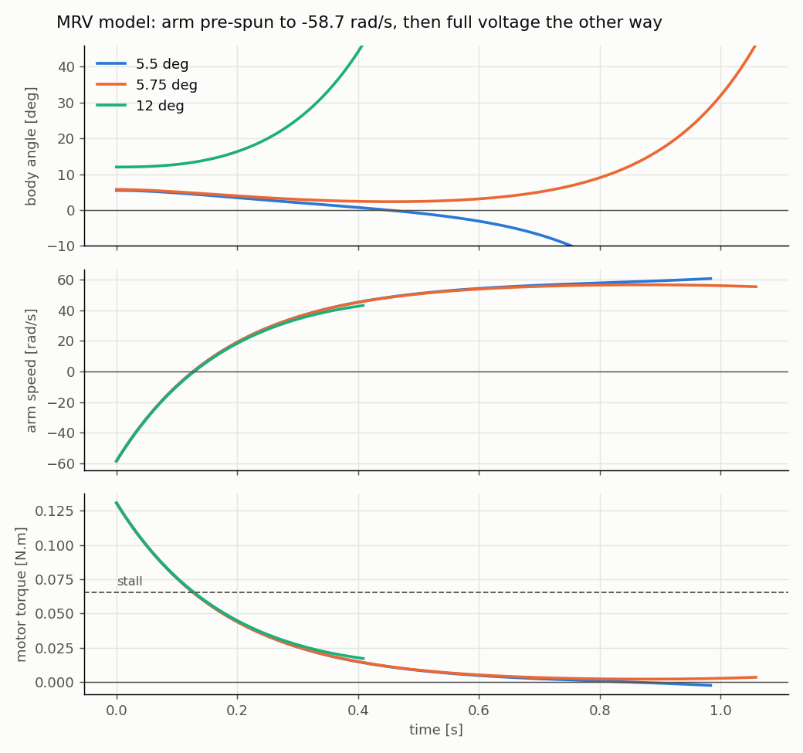

# isaac-ros-pendulum

A reaction-wheel inverted pendulum simulated in NVIDIA Isaac Sim and balanced by an LQR
controller running as a separate ROS 2 node. The controller talks only to standard ROS 2
topics, so it does not know whether the plant on the other end is Isaac or hardware.

**No Isaac Sim? You can still watch it.** The recorded runs replay in RViz with only ROS 2
installed; see [Watch a recorded run](#watch-a-recorded-run).

The pendulum's parameters are close to those of [MRV](https://github.com/termvato/MRV), a
monopedal jumping robot I built for my final-year project. This repo asks how far such a
robot can lean and still recover, and what limits it.

**Main results:**

- **The design is speed-limited, not torque-limited.** Removing the torque limit entirely only
  raises LQR's recoverable lean from 7.45 to 8.91 deg, and no controller could exceed 9.15 deg
  even with unlimited torque: the reaction arm's speed limit sets the boundary.
- **A learned controller cannot beat LQR here.** PPO trained in Isaac Lab and deployed as a
  drop-in ROS 2 node recovers the same 7.45 deg lean as LQR, and a linear program over every
  possible torque sequence shows no controller can recover more than 7.47 deg. PPO is weaker at
  despinning the arm afterwards (2 of 20 seeds). Full write-up:
  **[docs/ppo_vs_lqr.md](docs/ppo_vs_lqr.md)**.

## Interface

```
            /joint_states  (sensor_msgs/JointState, 240 Hz)
  Isaac Sim ───────────────────────────────────────────────▶ pendulum_controller
  (plant)   ◀─────────────────────────────────────────────── (120 Hz timer)
            /joint_command (sensor_msgs/JointState, effort)
            /clock         (rosgraph_msgs/Clock, sim time)
```

| Topic | Type | Direction | Contents |
|---|---|---|---|
| `/joint_states` | `sensor_msgs/JointState` | Isaac to controller | position and velocity of `base_body` and `body_arm` |
| `/joint_command` | `sensor_msgs/JointState` | controller to Isaac | `effort` on `body_arm` only |
| `/clock` | `rosgraph_msgs/Clock` | Isaac to all | simulation time |

### Why it is structured this way

- **The plant is swappable.** The controller subscribes and publishes and nothing else. Sim
  time is a runtime parameter (`use_sim_time`), never hardcoded, so the same node could run
  against hardware publishing the same two topics.
- **Standard messages only.** `sensor_msgs/JointState` in both directions is what Isaac's own
  ROS 2 Joint States graph uses by default, so no custom message types or conversion nodes
  are needed.
- **Only the arm is commanded.** `base_body` is the passive pivot between the pendulum and
  the ground. It has no motor on a real robot, so the command message never names it.
- **Joints are looked up by name, never by index**, because Isaac does not guarantee joint
  order in the message.
- **Timer-driven, not callback-driven.** The controller sets its own 120 Hz rate and acts on
  the latest stored state. That costs latency (measured: commands act on state 12.5 ms old),
  but it fixes the loop rate no matter when messages arrive.
- **Controllers are interchangeable.** `pendulum_policy` runs an ONNX policy exported from
  Isaac Lab behind exactly the same topics, rate and stale-state guard as the LQR node, so the
  harness evaluates a learned controller and LQR identically.
- **The controller reads the arm's velocity as well as the body's state.** This is not
  optional: without it, the arm is never slowed back down and ends up at its speed limit.
  The PD result below shows this happening.
- **Stale data commands zero.** If `/joint_states` is older than 50 ms, the controller
  publishes zero torque rather than going quiet, because Isaac keeps applying the last
  command forever. If no state has ever arrived, it publishes nothing.
- **Torque saturation lives in the controller.** Isaac enforces no motor torque limit, so the
  clamp (`max_torque`) is a ROS parameter on the controller.
- **Gains are ROS parameters**, so the PD comparison is the same node run with
  `-p k_w_arm:=0.0`.

## Controller

State `x = [theta_base, omega_base, omega_arm]`, input `u` = torque on the arm, law
`u = -Kx`. Arm angle does not appear, because the arm's centre of mass sits on its own axis,
so its angle has no effect on the dynamics.

The linearised model about upright is derived by hand from the URDF using Lagrange's
equations. The weights come from Bryson's rule, one budget per state: 0.785 rad of lean,
pi rad/s of body rate, 5 rad/s of arm rate. The torque weight is `R = 1e5`. The design script
is `analysis/lqr_design.py`.

Closed-loop poles: **-33.7** and a near-double pole at **-6.36 +/- 0.04j** rad/s.

- **Delay margin.** A pure delay T adds phase lag of roughly `omega * T`, so the fast mode
  goes unstable near `T = (pi/2) / 33.7 = 47 ms`. The measured loop delay is 12.5 ms (state
  to applied torque), so the margin is about 4x.
- **Settling time (2%) is 0.92 s**, matching a double pole at -6.36, where
  `(1 + st) e^(-st) = 0.02` gives `st = 5.8`.
- The -6.36 pair is pinned by the plant, not by tuning. As control gets more expensive, LQR
  moves the unstable open-loop pole to its mirror image in the left half-plane, not further.

## Results

The LQR boundaries in the table are bisected to 0.05 deg by the harness after its stale-command
fix (see [Bisected boundary](#bisected-boundary)), and every repeat agreed. The PD result, the
arm-speed table and the saturation figures below come from earlier hand sweeps: disturbances on
a 0.5 deg grid from 3.0 deg upward until the first fall, one run per setting, set by hand before
that fix. The disturbance is a body disturbance (the pendulum is set to an angle), not a torque
added to the command, which would be in the controller's own input space and test the easy case.

| Controller | Torque limit | Recovers | Fails | Physical limit, any controller |
|---|---|---|---|---|
| LQR | none | 8.906 deg | 8.953 deg | 9.15 deg |
| LQR | 0.05 N.m | 8.344 deg | 8.391 deg | 8.35 deg |
| LQR | 0.025 N.m | 7.453 deg | 7.500 deg | 7.47 deg |
| PD (`k_w_arm = 0`) | 0.025 N.m | fell at 4.0 deg in a hand sweep (see below) | | |

"None" means the controller's clamp is set to 1000 N.m (unclamped LQR asks for at most ~2.4 N.m).
The physical limit is the largest lean any torque sequence could recover under the same torque
limit and the 100 rad/s arm speed limit, from `analysis/recovery_limit.py` (method in
[docs/ppo_vs_lqr.md](docs/ppo_vs_lqr.md#the-physical-limit)). PD cannot be bisected: it never
despins the arm, so it fails the recovery definition at any lean.

**Speed-limited, not torque-limited.** Removing the torque limit entirely raises the physical
limit only from 7.47 to 9.15 deg, while removing the arm speed limit instead would raise it to
19.5 deg. In the hand sweeps, peak arm speed scaled with the initial lean at about 1100 to
1200 rad/s per radian, *whatever the torque limit*. That is momentum the arm must absorb, fixed
by the physics rather than by the gains, so with a 100 rad/s arm limit saturation starts near
5 deg. The torque limit only decides how long the arm stays saturated, and falls follow
sustained saturation (over ~0.4 s), not brief saturation. A faster or heavier arm is what
extends the range; a bigger motor buys at most 1.7 deg.

**Saturation is survivable, sustained saturation is not.** A saturated arm has zero
acceleration, so it exerts zero reaction torque on the body and the body falls freely until
the arm comes back under its limit. Near the boundary, a small increase in lean produces a
large jump in time spent saturated.

**Why the controller must read arm velocity.** PD never slows the arm down. Each recovery
leaves about 32 rad/s in the arm:

| Disturbance | PD arm speed, start to end | LQR arm speed, start to end |
|---|---|---|
| 3.0 deg | 0 to 32 rad/s | 0 to 0 |
| 3.5 deg | 32 to 64 rad/s | 0 to 0 |
| 4.0 deg | 64 to 100 rad/s, **fell** | 0 to 0 |

LQR handles 4 deg from rest with an 84 rad/s peak. PD fell because it started that
disturbance with only 36 rad/s of headroom. So PD's "limit" depends on what happened before
it, and is not a region of attraction at all. PD also settles the body faster (0.64 s vs
0.92 s), because it spends none of its effort slowing the arm.

**Peak torque grows at about 0.96 N.m per radian of lean.** The unclamped fall asked for
2.4 N.m, and Isaac applied it without complaint, which is why the clamp has to live in the
controller.

### Bisected boundary

`isaac/harness.py` replaces the hand-typed sweep: it sets the lean, holds the body there at
rest for 0.1 s while the controller reacts, releases it, runs a 10 s trial, judges it, and
bisects to 0.05 deg. **Recovered** is stricter than "did not fall": the body must be within
0.5 deg of upright **and the arm below 1 rad/s** at the end, because a real pendulum gets
pushed again and an arm left spinning has less headroom for the next push.

Results are in the table above. Every LQR recovery ended with the arm below 0.1 rad/s, so the
despin requirement cost LQR nothing. Per-trial data: `results/bisect_hold_lqr_*.csv` (`0p025`,
`0p05`, and `1000p0` for no limit).

**The hold is a bug fix.** Before it, a trial began with the previous trial's last command
still applied for a physics step. After a fall that was a full-torque kick, so each result
depended on how the trial before it ended, and the bisection measured the kick: LQR read
7.03 deg, and repeats flipped. Found by reconstructing the applied torque from the arm's
acceleration. Every harness number from before the fix (commit `4f87e24`) is superseded.


**Update rate is part of the controller.** Isaac Sim's standalone app steps 1/60 s frames by
default, which delivered state to the controller at 60 Hz instead of 240 Hz. At that rate the
same LQR, with the same 0.025 N.m clamp, **fell from 3 deg**. Nothing reported an error; the
harness now pins one frame to one 240 Hz physics step, and starts every bisection with a 3 deg
must-recover / 15 deg must-fall sanity pair so a misconfigured run aborts instead of
producing a number.

### Timing, sim versus hardware

In sim time the loop is exact: `/joint_states` arrives every 4.167 ms and `/joint_command`
every 8.333 ms, with zero variation in every bag. That is an artefact of quantised sim time:
the 120 Hz timer lands on every second physics step. Hardware will have real jitter. Note
also that `ros2 topic hz` measures wall-clock arrival, which under `use_sim_time` is not the
loop rate (Isaac ran at about 0.3x real time here).

## Learned controller

PPO trained in Isaac Lab on the same plant, limits, observations and recovery definition,
exported to ONNX and run by `pendulum_policy` through the same harness.


- **Catch:** the best policies recover 7.45 deg through ROS, the same as LQR, against a physical
  limit of 7.47 deg. My prediction was that PPO would win by saturating the arm harder; LQR was
  already within 0.02 deg of the limit.
- **Despin:** only 2 of 20 seeds at 500 iterations, and 1 of 10 at 2000, end with the arm below
  1 rad/s. The rest park it at a steady speed. Reward shaping, a multiplicative reward and longer
  training did not fix it.
- Lab and ROS agree to within the evaluation grid, so the interface is transparent to a learned
  controller as well.

Method, all results, what failed and how to reproduce: [docs/ppo_vs_lqr.md](docs/ppo_vs_lqr.md).

## MRV: an open discrepancy between the model and the robot

The pendulum above is a benchmark. `urdf/mrv.urdf` models MRV itself, pinned at its foot so it
can only tip about one axis: 358 g measured on a scale, centre of mass 210 mm above the foot,
each reaction arm carrying two 14.1 g weights 158.5 mm apart. The 50:1 gearmotor is modelled
by its datasheet torque-speed line scaled to the 8 V supply: 0.0653 N.m at stall, 58.7 rad/s at
no load, and up to twice stall torque when driven against an arm already spinning the other
way (plugging).

**Bench test.** MRV's foot sat in a jig with bearings that allowed rotation about one axis
only, with one arm driving, and the lean read with a protractor. The arm was spun to full speed
one way, the body was held still at about 12 deg and released, and full voltage was commanded
the other way. It recovered from **about 12 deg**.

**Model.** The largest lean any controller could recover, by the same linear program as the
benchmark: **2.8 deg** with the arm starting at rest, **5.6 deg** with it pre-spun as on the
bench. An open-loop re-enactment in Isaac Lab with full nonlinear physics (`rl/mrv_bench.py`)
agrees: 2.75 and 5.5 deg. At the datasheet speed, even an infinitely strong motor has a
momentum ceiling of 12.4 deg (`I_a x 117 rad/s / sqrt(mgl x I_p)`), and getting to 12 deg would
take about 50 times the stall torque. So no realistic torque explains the bench result at the
datasheet speed.



*The bench manoeuvre in Isaac Lab on the MRV model. Plugging gives twice stall torque at first,
but it fades as the arm passes zero and speeds up. The model recovers 5.5 deg and falls from 5.75;
from 12 deg it is gone within half a second.*

**What would have to be true.** No single parameter in a plausible range closes the gap:

- **Faster motor, datasheet torque:** not enough at any speed. A 300 rad/s no-load speed (5x)
  still only reaches 8.8 deg, because torque then binds.
- **Heavier arm:** 3x the arm inertia reaches 8.0 deg.
- **Faster and stronger motor together:** about **2.15x the datasheet's torque and speed at once**
  (126 rad/s no-load, 0.14 N.m stall, as if the motor ran at ~17 V) makes 12 deg possible.

**Unresolved.** The leading hypothesis is that the real motors deliver well beyond the 8 V
datasheet figures, which come from a single sample tested at 6 V and scaled linearly. The planned
test is to measure MRV's actual torque-speed curve at 8 V: stall torque and no-load speed. If
the motor matches the datasheet, the remaining suspects are the bench itself (the protractor
reading, help from the jig or cable) and the model's mass properties.

## Watch a recorded run

Needs only ROS 2 Jazzy (with `ros-jazzy-desktop`, which includes RViz):

```bash
git clone https://github.com/termvato/isaac-ros-pendulum.git
cd isaac-ros-pendulum
source /opt/ros/jazzy/setup.bash
ros2 launch launch/pendulum_launch.py bag:=bags/sweep_pd_0p025 rate:=3.3
```

This replays a bag in RViz: the bag supplies `/joint_states` and `/clock`, and
`robot_state_publisher` turns them into transforms. `bag:=` picks the run (default
`sweep_inf`). `sweep_pd_0p025` shows the PD wind-up: the arm spins faster after each
disturbance until it hits its limit and the body falls. `rate:=1.0` replays at the pace it
was recorded, which is about 0.3x real time because that is how fast Isaac ran. `3.3` is
roughly real time.

The recorded `/clock` is replayed rather than using `ros2 bag play --clock`, which would
publish the bag's wall-clock receive times and disagree with the sim-time stamps in the
messages.

## Reproduce with Isaac Sim

Tested on Ubuntu 24.04, ROS 2 Jazzy, Isaac Sim 5.1.0 (workstation zip), RTX 4070 Laptop.
**Use NVIDIA driver 580.** Driver 595 crashes Isaac Sim 5.1 during RTX renderer start-up
([isaac-sim/IsaacSim discussion #648](https://github.com/isaac-sim/IsaacSim/discussions/648)).

```bash
git clone https://github.com/termvato/isaac-ros-pendulum.git
cd isaac-ros-pendulum
source /opt/ros/jazzy/setup.bash
colcon build --symlink-install
source install/setup.bash
```

1. **Start Isaac with the ROS 2 bridge**, from a terminal where Jazzy is sourced:
   `cd ~/isaacsim && ./isaac-sim.sh --enable isaacsim.ros2.bridge`. Open
   `isaac/first_pendulum.usd` (the file browser needs an absolute path) and press Play.
   Keep `isaac/` and `urdf/` side by side, since the stage references the robot at
   `../urdf/body`.
2. **Run the controller:**
   ```bash
   ros2 run pendulum_nodes pendulum_controller --ros-args -p use_sim_time:=true -p max_torque:=0.05
   ```
   For PD, add `-p k_w_arm:=0.0` (the `.0` matters: the parameter is a double).
3. **Record:** `ros2 bag record -o my_run --topics /clock /joint_states /joint_command`,
   started after Isaac is playing, so the topics exist.
4. **Disturb:** in Isaac, set the `base_body` joint position (the field is in degrees; ROS
   reports radians). Let it settle before the next one.
5. **Analyse:**
   ```bash
   python3 analysis/bag_reader.py my_run 0.05
   ```
   Arguments are the bag, the torque limit (default `inf`) and the arm speed limit
   (default 100 rad/s). Neither limit is recorded in the bag, so both are passed in. To
   see the published results, point it at the bags in `bags/`.

### Automated bisection

Runs Isaac Sim headless and finds one controller's boundary in about two minutes.

```bash
# terminal 1: the controller under test, exactly as above
ros2 run pendulum_nodes pendulum_controller --ros-args -p use_sim_time:=true -p max_torque:=0.025
# terminal 2: the harness
./isaac/run_harness.sh --label lqr_0p025          # add --gui to watch
```

For a learned policy, run `pendulum_policy` in terminal 1 instead (see
[docs/ppo_vs_lqr.md](docs/ppo_vs_lqr.md#reproduce)). The result lands in
`results/bisect_<label>.csv`. `run_harness.sh` launches the script with a
clean environment pointed at Isaac Sim's bundled ROS 2 libraries: the harness itself uses
`rclpy` (to check the controller is publishing), and system Jazzy's `rclpy` is built for
Python 3.12 while Isaac runs 3.11. The controller still runs on system ROS and connects
normally. The harness only plays the plant, sets the initial lean and judges the outcome; the
controller is an ordinary ROS 2 node and does not know it is being tested.

### Metric definitions

- **Disturbance:** a `base_body` jump of more than 2 deg in one physics step. Physics alone
  moves the body at most 1.6 deg per step, during a fall.
- **Fell:** `|theta|` exceeds 45 deg.
- **Recovered (harness):** did not fall, and after 10 s of sim time `|theta| < 0.5 deg` and
  `|omega_arm| < 1 rad/s`.
- **Settling time:** time from the disturbance until `theta` enters, and never again leaves,
  +/-2% of the initial lean, in sim seconds.
- **Saturation time:** total sim time above 99% of the limit (arm speed or torque).

All times use `header.stamp` (sim time), not bag receive time (wall clock).

## Repository

```
analysis/bag_reader.py        bag -> per-disturbance metrics table
analysis/lqr_design.py        LQR gain design from the linearised model
analysis/plant_model.py       linearised model computed from a URDF (tested against lqr_design)
analysis/recovery_limit.py    largest recoverable lean for any controller, as a linear program
analysis/plot_*.py            figures
bags/                         the four sweeps in the results table
config/limits.yaml            torque limit shared by both nodes and the Isaac Lab env
docs/ppo_vs_lqr.md            the learned-controller comparison
docs/journal.md               how the project went, including the wrong turns
isaac/first_pendulum.usd      Isaac stage: physics, drives, ROS 2 OmniGraph
isaac/harness.py              headless Isaac Sim: set lean, judge trial, bisect boundary
isaac/run_harness.sh          launches the harness on Isaac's bundled ROS 2 libraries
rl/                           Isaac Lab env, PPO config, Lab evaluation, LQR as a policy
results/                      bisections, learning curves, figures, predictions
scripts/                      train_eval.sh and the batch scripts behind each result
src/pendulum_nodes/           the LQR node and the ONNX policy node
tests/                        unit tests: PYTHONPATH=. ~/isaacsim/python.sh -m pytest tests
urdf/body.urdf                pendulum description (masses, inertias, limits)
urdf/body/                    URDF imported into USD by Isaac, referenced by the stage
urdf/mrv.urdf                 MRV, the real robot, for later sim-to-real work
launch/pendulum_launch.py     replay a bag in RViz, no Isaac needed
rviz/                         RViz config
```

## Limitations and next steps

- **The bagged sweeps were set by hand** in the Isaac GUI. The harness has since bisected LQR at
  all three torque settings; the PD figure and the saturation measurements still come from the
  hand sweeps.
- **The harness tests release from a held lean, not an unannounced push.** Holding the body
  while the controller reacts gives every controller a correct first command. A push on
  hardware arrives mid-loop, and the 12.5 ms delay then matters more.
- **The ROS interface lives inside a binary `.usd`.** It should be exported as a Python graph
  script so it can be read and diffed.
- **No Isaac-side watchdog.** If the controller dies, Isaac keeps applying its last command.
- **The replay launch file is for bags, not live runs.** Run alongside Isaac, the bag and
  Isaac would both publish `/joint_states` and `/clock`.
- **The bagged sweeps are one run per torque limit at 0.5 deg resolution**, set by hand while
  the controller was running, so each disturbance started on a stale command, as in the old
  harness. Their boundaries are not directly comparable with the harness's.
- **The harness's logged command (`effort` in `traj_*.csv`) is what the harness received, which
  can lag the torque physics applied by tens of ms.** Use `I_a d(w_arm + w_base)/dt` for the
  applied torque.
- **The model matrices in `lqr_design.py` are typed in by hand.** `analysis/plant_model.py`
  computes them from the URDF and a unit test checks they agree.
- **Sim only.** No hardware results yet.
