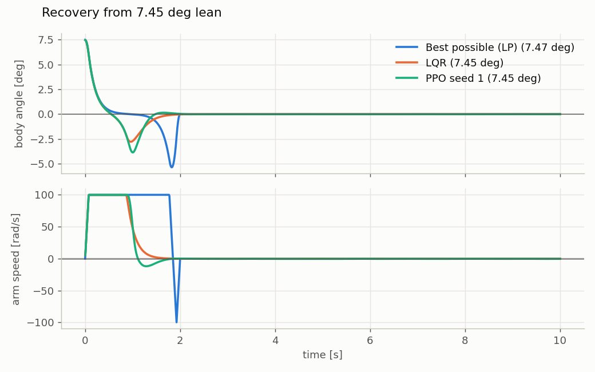
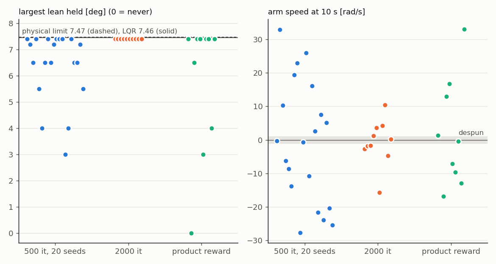
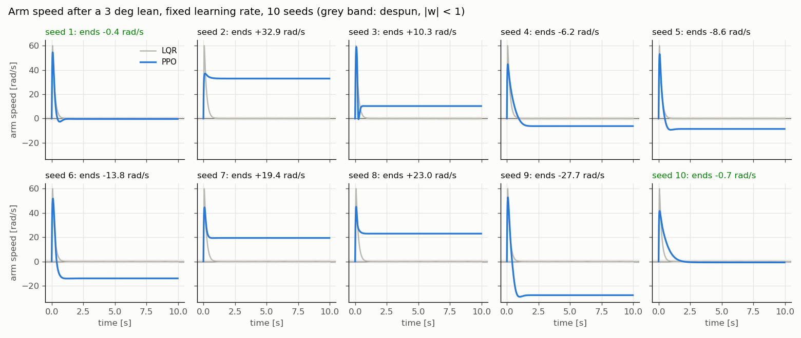
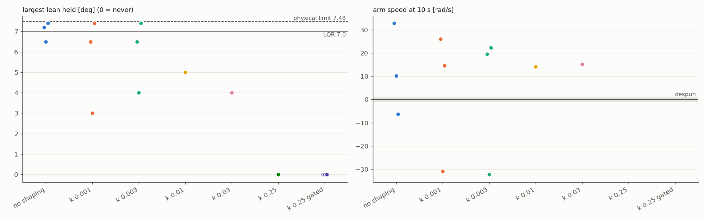
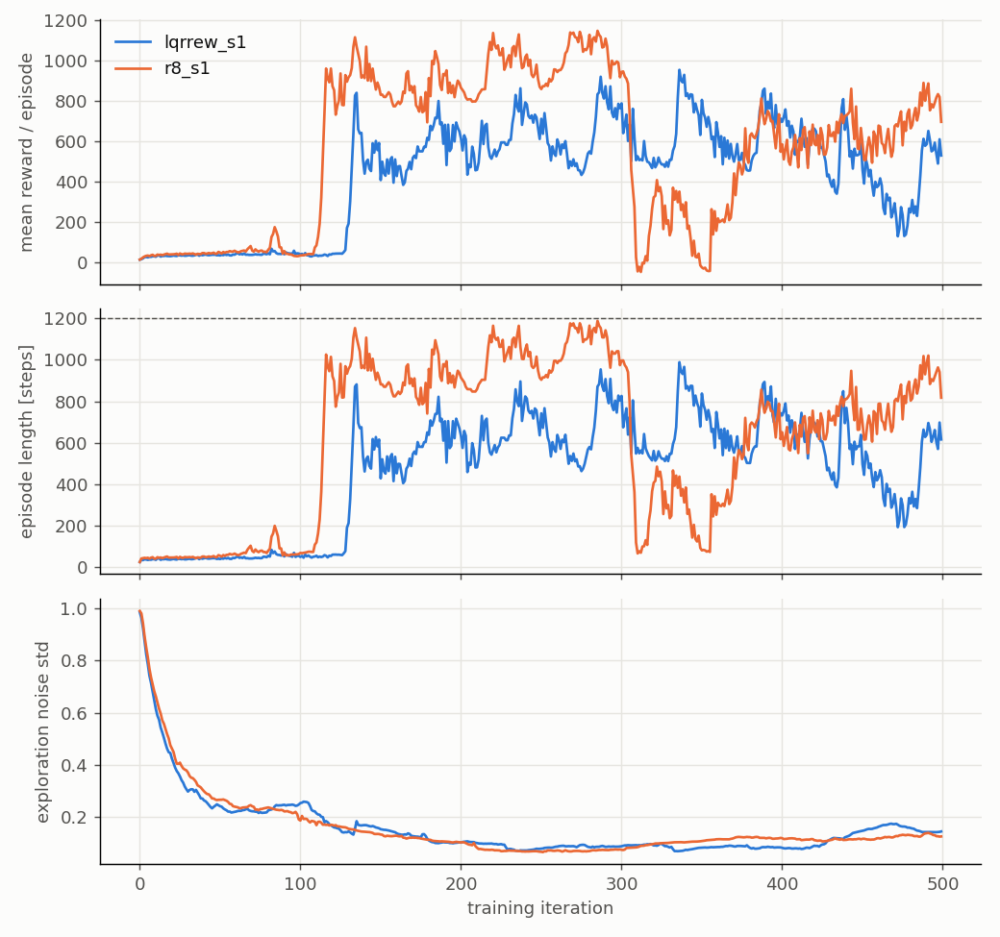
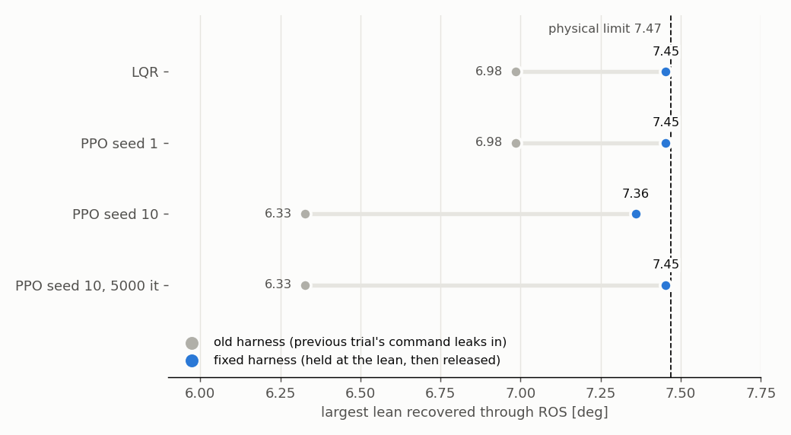
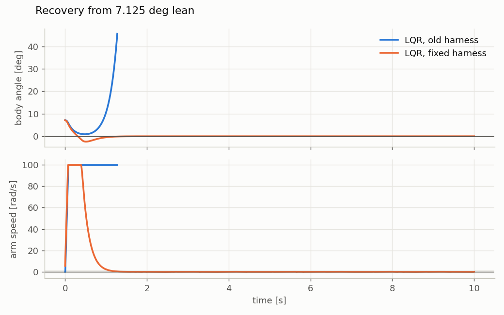

# Can a learned controller beat LQR at recovering a lean?

**No, and the reason is measurable.** Under identical torque and arm-speed limits, PPO matched
LQR but could not beat it: both recover a **7.45 deg** lean through ROS, and a linear program
over every possible torque sequence shows that no controller can recover more than **7.47 deg**.
LQR was already within 0.02 deg of the physical limit, so there was nothing left to win on the
catch. Where PPO is weaker is finishing the job: only **2 of 20** training seeds fully despin
the reaction arm.



*Recovery from 7.45 deg through the ROS interface. LQR and the best PPO policy both saturate
the arm at 100 rad/s for ~0.9 s, swing the body past upright, and despin. The linear-program
trajectory ("best possible", from 7.47 deg) stays saturated longer and despins later.*

The day-by-day record, including every wrong turn, is in [journal.md](journal.md). Predictions
were written before results, in [results/predictions.md](../results/predictions.md).

## The question and the prediction

The pendulum is speed-limited: a recovery past ~5 deg spins the arm into its 100 rad/s limit,
and a saturated arm exerts no torque on the body (see the main [README](../README.md)). LQR is
linear and knows nothing about saturation, so the question was whether a learned policy,
trained with the limits in the loop, finds a better way to spend the arm's speed budget.

My prediction, written before any PPO result: *"our PPOs will beat LQR simply because we did
not tune LQR at all, and there might be room to improve by saturating faster."* Wrong, as it
turned out, because of the physical limit below.

## Identical conditions

| | LQR | PPO |
|---|---|---|
| Plant | `urdf/body.urdf` | same, imported into Isaac Lab |
| Observations | body angle, body rate, arm speed | same three, same order |
| Torque limit | 0.025 N.m (`config/limits.yaml`) | same file |
| Arm speed limit | 100 rad/s (URDF) | same |
| Rate | 120 Hz control, 240 Hz physics | same |
| Recovered | never past 45 deg; at 10 s within 0.5 deg of upright and arm below 1 rad/s | same |
| Evaluated | ROS 2 node + `isaac/harness.py` | same harness, `pendulum_policy` node |

The policy node is a drop-in sibling of the LQR node: same topics, same 120 Hz timer, same
stale-state guard. The harness cannot tell them apart.

**Training** (Isaac Lab 2.3.2, rsl_rl PPO, defaults in `rl/`): 4096 parallel environments,
10 s episodes, starts uniform within +-8 deg, training episode ends past 15 deg. The reward is
LQR's own cost, `r = 1 - 0.005 (x'Qx + R u^2)` with the same Q and R as the LQR design, so both
controllers optimise the same objective. gamma 0.997, fixed learning rate 1e-3, [32, 32]
networks. 500 iterations take ~7 min including Isaac start-up, export and evaluation.

## The physical limit

`analysis/recovery_limit.py` asks: over every torque sequence at 120 Hz with |torque| <=
0.025 N.m and |arm speed| <= 100 rad/s, what is the largest starting lean from which the body
can be brought upright and still? On the linearised plant the state is linear in the starting
lean and the torques, so this is a linear program and the solver returns the true optimum, with
no training and no seeds.

- **7.47 deg**, whether or not the arm must also end despun (despin costs nothing).
- Remove the arm speed limit: 19.5 deg (the torque-only bound, also by hand). Double the torque:
  only 8.35 deg. The speed limit is what binds, as measured on LQR in September.
- Not in the bound: sin(theta) vs theta (~0.3% at 8 deg) and how PhysX handles the speed limit.

## Results

| | Recovers (ROS) | Recovers (Lab) | Arm at 10 s |
|---|---|---|---|
| Physical limit (LP) | 7.47 deg | | |
| LQR | **7.45 deg** | 7.46 deg | 0.0 rad/s |
| PPO seed 1, 500 iterations | **7.45 deg** | 7.46 deg | -0.4 rad/s |
| PPO seed 10, 500 iterations | 7.36 deg | 7.3 deg | -0.8 rad/s |
| PPO seed 10, 5000 iterations | **7.45 deg** | 7.45 deg | +0.3 rad/s |

ROS boundaries are bisected to 0.05 deg (recovers 7.453, fails 7.500) and repeat exactly. Lab
and ROS agree to within the grid spacing, so the learned policies transfer through the ROS
interface unchanged. Seed 10 at 5000 iterations was picked because it was the best seed, so it
shows what one policy can reach, not how often.

### Across seeds: the catch converges, the despin does not



*Each dot is one training seed, evaluated in Lab on a grid (3, 4, 5, 5.5, 6, 6.5, 7, 7.2, 7.4,
7.6 deg; 7.4 is the top of the grid below the limit). Left: largest lean held. Right: arm speed
10 s after that lean; the grey band is the despin requirement.*

- **500 iterations, 20 seeds:** the largest lean held ranges 3 to 7.4 deg, and only 2 seeds
  despin. The rest catch the lean and then park the arm at a steady speed between -28 and
  +33 rad/s.
- **2000 iterations, 10 seeds:** every seed reaches 7.4 deg, and the parked speeds shrink
  towards zero (8 of 10 within 5 rad/s), but only 1 of 10 is under 1 rad/s. Training longer
  pulls towards despin, slowly and not monotonically: seed 1 was despun at 500 iterations and
  parked at -2.7 rad/s at 2000.



**Why the arm parks.** Each seed parks at the same speed from every starting lean, so the
parked speed is a property of the policy, not of the recovery. An early policy queried
directly, body upright and still, commanded full torque one way below 58 rad/s and the other
way above it: it had learned to regulate the arm to 58 rad/s instead of 0. Draining that speed
means leaning the body so gravity can absorb the momentum, which pays off seconds later. With
gamma 0.997 at 120 Hz the policy weighs about 2.8 s ahead, and the per-step cost of a parked arm
is small, so a local optimum at a non-zero speed is stable.

## What did not fix the despin

Each change was one variable, with a prediction written first.

| Change | Result |
|---|---|
| Hand-made reward (upright bell, gated arm penalty) to LQR's cost | no despin in 5 seeds |
| Starts narrowed from +-12 to +-8 deg | parked speeds tighter, 0 of 10 despun |
| Adaptive learning rate to fixed 1e-3 | no more training crashes; first 2 despun seeds |
| Potential-based shaping on arm speed (Ng et al. 1999), k = 0.001 to 0.25 | no despin; larger k weakens the catch; k = 0.25 never balances |
| The same shaping, gated to near upright | never balances: rewarded leaving upright with a spinning arm (a design error) |
| Multiplicative reward, DeepMind Control Suite style | 1 of 10 despun, catch worse |
| 2000 and 5000 iterations | catch converges; despin 1 of 10 |

The common thread: every catch must spin the arm up, so any reward on arm speed either bills
the catch or, gated, pays for abandoning upright.



**The training crashes** came from rsl_rl's adaptive learning-rate schedule. It raises the rate
whenever an update changes the policy less than a KL target. A converged policy barely changes,
so the rate climbed to its 0.01 cap and one large update broke the critic (value loss 5 to 775).
PPO's clip did not prevent it, because each batch gets 20 gradient steps.



## Evaluation bugs, each of which produced a plausible wrong number with no error

1. **Isaac Sim's standalone app steps physics at 60 Hz by default.** LQR fell from 3 deg.
2. **PhysX applies default angular damping to every rigid body**, which the URDF never mentions.
   The body settled at 0.043 deg instead of 0. Now zeroed explicitly in both simulators.
3. **Isaac Lab auto-resets an environment that falls**, so an evaluation that keeps recording
   sees a fall followed by a "recovery". The first Lab result said PPO held 9 deg. Evaluation now
   stops at the first fall.
4. **The ROS harness leaked the previous trial's command into the next trial.** After a trial
   fell, the next one started with one physics step of full torque, pushing whichever way the
   last controller output did. Every boundary pair in the old bisections was "recovered straight
   after a fall, fell straight after a recovery": the harness was measuring the kick. LQR read
   ~7.0 deg instead of 7.45. Found by reconstructing the torque physics actually applied from the
   arm's acceleration, `I_a d(w_arm + w_base)/dt`, because the harness's own command log turned
   out to run up to 75 ms late. Fixed by holding the body at the starting lean for 0.1 s while
   the controller catches up, then releasing it.





The same reconstruction measured the real loop delay: commands act on state 12.5 ms old (3
physics steps). Once trials start cleanly it costs less than 0.05 deg.

## Predictions against outcomes

| Prediction (mine, written first) | Outcome |
|---|---|
| PPO beats LQR by saturating faster | No: LQR is within 0.02 deg of the limit; a tie |
| Seed spread ~1 deg | ~2 deg on the first reward; 3 to 7.4 deg at 500 iterations |
| LQR's reward gives 7.4 deg and a despun arm | 7.4 deg yes, despin no (0 of 5) |
| Narrower starts give smoother learning curves | No: crashes continued |
| Fixed learning rate gives fewer crashes | Yes: none |
| Shaping at k = 0.25: 5 of 10 despin | Never learned to balance |
| One or two more seeds despin out of luck (seeds 11-20) | None did |
| Seed 10 at 5000 iterations stays despun, slightly better, ROS about equal to LQR | Right on all three, once the harness was fixed |

## Reproduce

Needs Isaac Lab 2.3.2 with rsl_rl at `~/IsaacLab` (Isaac Sim 5.1, NVIDIA driver 580) and ROS 2
Jazzy; see the main README for the Isaac Sim setup.

```bash
# train, export and evaluate one PPO seed in Isaac Lab with the defaults above (~7 min)
scripts/train_eval.sh 1
# LQR as a TorchScript policy, evaluated by the same Lab script
~/isaacsim/python.sh rl/lqr_policy.py --out logs/lqr/policy.pt
PYTHONPATH=. ~/IsaacLab/isaaclab.sh -p rl/lab_eval.py --headless --policy logs/lqr/policy.pt \
    --angles 7.2 7.3 7.4 7.42 7.44 7.46 7.48 7.5 --out results/lab_lqr.csv
# the physical limit
python3 analysis/recovery_limit.py --despin
# through ROS: the policy node in one terminal, the harness in another
ros2 run pendulum_nodes pendulum_policy --ros-args --params-file config/limits.yaml \
    -p model:=$PWD/logs/rsl_rl/pendulum_direct/<run>/exported/policy.onnx -p use_sim_time:=true
./isaac/run_harness.sh --label ppo_s1
# unit tests (reward, LQR policy, action delay, plant model)
PYTHONPATH=. ~/isaacsim/python.sh -m pytest tests -q
```

Training is deterministic per seed: seed 1 retrained with `scripts/train_eval.sh 1` gives a Lab
evaluation identical to the published one in every row. The batch scripts behind every figure are in `scripts/`.

## What I would try next

- **Probe the parked speed.** Sweep arm speed at upright for each seed and check that the
  policy's torque crosses zero at its parked speed (my prediction). Then the question becomes
  how to move that crossing to zero.
- **Treat despin as a constraint, not a reward:** Constraints as Terminations (Chane-Sane et al.
  2024) works with plain PPO.
- **Residual RL** (Johannink et al. 2018): learn a correction on top of LQR, which already
  despins. That changes the question to whether learning can extend LQR's boundary, which this
  plant says it cannot by more than 0.02 deg.
- **A plant where LQR is not already at the limit**, such as MRV with its real motor's
  torque-speed curve, where saturation shapes more of the recovery.

## Files

```
rl/pendulum_env.py          Isaac Lab env: same plant, limits and observations as the ROS loop
rl/agents/                  PPO hyperparameters (final defaults)
rl/rewards.py               product reward, kept for reproduction (not the default)
rl/lqr_policy.py            the LQR law as a TorchScript policy, for like-for-like Lab evaluation
rl/lab_eval.py              evaluate a policy in Lab from fixed leans, stop at the first fall
rl/delay.py                 action delay for lab_eval (--delay)
rl/lab.py                   runs Isaac Lab's train.py and play.py with the env registered
analysis/recovery_limit.py  the linear-program limit
analysis/plant_model.py     linearised A, B straight from a URDF
analysis/plot_*.py          every figure here
src/pendulum_nodes/pendulum_nodes/pendulum_policy.py   the ONNX policy as a ROS 2 node
scripts/                    train_eval.sh, and the batch scripts behind each result
tests/                      unit tests
results/lab_ppo_*.csv       Lab evaluations (trajectories, kept locally, not committed)
results/bisect_*.csv        ROS harness bisections; bisect_hold_* are after the fix
results/training/           learning curves exported from TensorBoard
```
